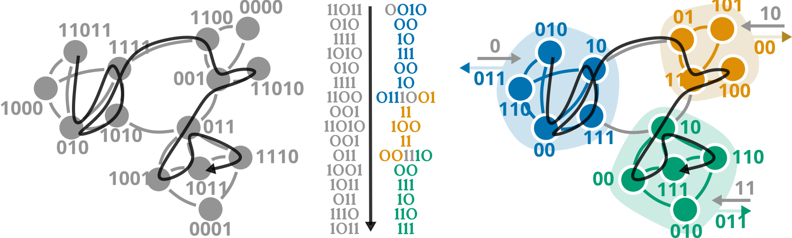
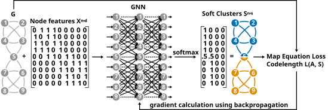

# Neuromap
Companion repository for the paper **The Map Equation Goes Neural: Mapping Network Flows with Graph Neural Networks** by Christopher Blöcker, Chester Tan, and Ingo Scholtes, to appear at NeurIPS 2024.
The paper adapts the map equation, an information-theoretic objective function for community detection, as a loss function for detecting communities with (graph) neural networks.

## How the map equation works
The map equation is an information-theoretic objective function for community detection in complex networks.
The map equation adopts a compression perspective and quantifies how efficiently a random walk on a network can be described based on the given communities.
Those communities that lead to the best compression are considered to describe the organisational structure of the network well.
The map equation's basic principles are described in the paper; more detailed explanations can be found in [Community Detection with the Map Equation and Infomap: Theory and Applications](https://arxiv.org/abs/2311.04036).

The basic principle goes like this: (1) split the network into communities; (2) assign codewords to the nodes that are unique within each community, for example using Huffman codes; (3) compute how many bits are required per step that a random walker takes on the network -- this is the so-called codelength. The lower the codelength, the better the partition from step (1).
**In practice** no codewords or random walks are used, instead, the map equation computes the codelength analytically.




## How Neuromap works
"Neuromap" refers to using the map equation as a loss function in combination with (graph) neural networks to learn (soft) cluster assignments (communities).
The figure below shows the general setup, where the input consists of a graph, and the output is a soft cluster assignment matrix, optimised in an unsupervised fashion by minimising the map equation through gradient descent.



The core component is the (two-level) map equation, which can be expressed as follows in Python, using `torch`:

```python
class MapEquationPooling(torch.nn.Module):
    def __init__(self, adj: Tensor, *args, **kwargs) -> None:
        super().__init__(*args, **kwargs)

        self.F, self.p = mkSmartTeleportationFlow(adj)

        # store the adjacency in CSR format; a product with a COO matrix converts it to CSR on every call
        self.adj = adj.coalesce().to_sparse_csr()

        # this term is constant, so only calculate it once
        self.p_log_p = torch.sum(self.p * torch.nan_to_num(torch.log2(self.p), nan = 0.0))

    def forward(self, x, s):
        # multiply F @ s first; s.T @ F with F in CSR format is 2 to 6 times slower
        C = s.T @ (self.F @ s)

        # flows between modules, summed from the off-diagonal entries of C
        # subtracting the diagonal from the row sums would round a flow of 1e-8 next to a flow near 1 to 0
        C_between = C - torch.diag(torch.diag(C))

        q      = torch.sum(C_between)
        q_m    = torch.sum(C_between, dim = 1)
        m_exit = torch.sum(C_between, dim = 0)
        p_m    = q_m + torch.sum(C, dim = 0)

        # clamp the input to log2, so that a flow of 0 gets a finite gradient instead of 0/0
        codelength = torch.sum(q      * torch.log2(q.clamp_min(1e-30))) \
                   - torch.sum(q_m    * torch.log2(q_m.clamp_min(1e-30))) \
                   - torch.sum(m_exit * torch.log2(m_exit.clamp_min(1e-30))) \
                   - self.p_log_p \
                   + torch.sum(p_m    * torch.log2(p_m.clamp_min(1e-30)))

        x_pooled   = torch.matmul(s.T, x)
        # multiply adj @ s first, for the same reason as F @ s above
        adj_pooled = s.T @ (self.adj @ s)

        return x_pooled, adj_pooled, codelength
```

The self-contained `example-usage.py` notebook is intended to provide a minimal example as a starting point.

## Requirements
To run the code in this repository, you will need a couple of libraries.
Since the _exact_ setup varies somewhat depending on the available hardware (GPU available or not?), please refer to the documentation of the respective library.
* [PyTorch](https://pytorch.org/)
* [PyG](https://pytorch-geometric.readthedocs.io/en/latest/)
* [PyTorch Geometric Signed Directed](https://pytorch-geometric-signed-directed.readthedocs.io/en/latest/index.html)
* [Open Graph Benchmark (OGB)](https://ogb.stanford.edu/)
* The implementation of [NOCD](https://github.com/shchur/overlapping-community-detection), a baseline that is used in the experiments
* Infomap as a baseline, which is available as the Python package `infomap`
* Some "standard" Python libraries: `matplotlib`, `seaborn`, `scikit-learn`, `networkx`
* Some synthetic LFR networks that are [available here](https://doi.org/10.5281/zenodo.13961218) (generated with code [available here](https://sites.google.com/site/andrealancichinetti/benchmarks))
* The results of our experiments can be found [here](https://doi.org/10.5281/zenodo.13961218)

Or perhaps you are just interested in looking at the plots of the results, which are included in the notebooks.

## Citation
If you're using Neuromap, please cite
```bibtext
@inproceedings{blocker2024mapequationgoesneural,
  title={The Map Equation Goes Neural: Mapping Network Flows with Graph Neural Networks},
  author={Christopher Bl{\"o}cker and Chester Tan and Ingo Scholtes},
  booktitle={The Thirty-eighth Annual Conference on Neural Information Processing Systems},
  year={2024},
  url={https://openreview.net/forum?id=aFWx1N84Fe}
}
```
